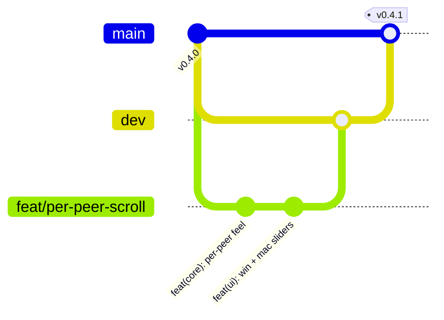

# Crossflow 开发与协作规范

本项目以纯 **Rust** 共享核心为基础，配合原生 **WinUI 3（Windows）** 与 **SwiftUI / AppKit（macOS）** 客户端。协议、加密、会话与多屏状态一律留在共享模块，操作系统底层接口严格隔离在 `src/platform/` 下，避免复制平台专属核心。

---

## 1. 分支模型（Branching Strategy）

采用轻量化 **双主干分支模型（`main` + `dev`）**：

| 分支 | 定位 | 规则 |
| :--- | :--- | :--- |
| **`main`** | **稳定发布分支** | 始终保持可发版状态；**禁止直接推送日常开发提交**，仅接受已通过双端验证的 `dev` 合并或紧急 `hotfix/*` 合并，每次发版在此分支打 `vX.Y.Z` 标签。 |
| **`dev`** | **日常集成分支** | Windows ↔ macOS 双机联调与持续集成默认工作分支；所有新功能与常规缺陷修复均先合入 `dev` 验证通过。 |
| **`feat/<name>`** | 功能分支 | 从 `dev` 切出（如 `feat/corner-deadzone`），开发自测完成后合回 `dev` 并删除。 |
| **`fix/<name>`** | 缺陷修复分支 | 从 `dev` 切出（如 `fix/wake-reconnect`），修复验证后合回 `dev` 并删除。 |
| **`hotfix/<name>`** | 线上紧急修复 | 从 `main` 切出，验证后**同时合回 `main` 与 `dev`**，并在 `main` 补发补丁版本（如 `v0.4.2`）。 |
| **`docs/<name>`** / **`chore/<name>`** | 文档与工程配置 | 视发布节奏从 `dev` 切出并合回 `dev`；纯公开主页/文档急修可在评审后同步至 `main`。 |

> **双机联调约定**：日常开发时 Windows 与 macOS 工作区默认均停留在 `dev` 分支，通过 `origin/dev` 同步代码与实机联调，不触碰 `main`。

---

## 2. 提交信息规范（Conventional Commits）

所有提交统一使用 `<type>(<scope>): <subject>` 格式（简洁明了，围绕单一可验证变更）：

| Type | 说明 | 示例 |
| :--- | :--- | :--- |
| `feat` | 新功能 | `feat(mesh): add per-peer cursor speed and scroll inversion` |
| `fix` | 缺陷修复 | `fix(win): unify INPUT_ORIGIN_TAG to prevent control revoke` |
| `perf` | 性能或延迟优化 | `perf(mac): reduce event tap callback latency` |
| `refactor` | 重构（不改变对外行为） | `refactor(hotkeys): extract prefix matcher` |
| `test` | 补充或修正测试 | `test(routed): verify fractional scroll remainder clamping` |
| `docs` | 文档、README、CHANGELOG | `docs(readme): add bilingual switcher and showcase` |
| `chore` | 构建脚本、CI、发版流程 | `chore(release): prepare v0.4.1 changelog` |

常用 `scope`：`core`、`mesh`、`routed`、`hotkeys`、`aux`、`win`、`mac`、`service`、`ui`、`docs`、`release`。

---

## 3. 开发与验证清单

提交合并至 `dev` 前，须按变更影响范围完成对应检查（仅通过 Windows 编译**不代表** macOS 适配层已编译或实测）：

### Rust 核心
- **Windows**：`.\scripts\cargo-local.ps1 test --lib`（0 警告、全部通过）
- **macOS**：`cargo test --lib`（0 警告、全部通过）
- 涉及协议、输入状态、快捷键或安全机制的改动，必须补充能够暴露边界错误的单元测试（非法字段、越界值、过期租约、乱序/重复事件、断线重连等）。

### 客户端构建与实机验证
- **Windows**：`.\scripts\build-windows-ui.ps1 -Configuration Release`（0 警告、0 错误）
- **macOS**：编译 Release 内核与 SwiftUI（`scripts/build-macos-ui.sh`），使用开发证书重签并验证 `CrossflowMac` 与 `crossflow peer` 正常启动。
- **双机联调**：实机验证 Windows ↔ macOS 跨屏穿越、快捷键、剪贴板/文件及受影响功能。未测项在说明中如实标注「未测」，不虚报效果。

---

## 4. 标准化发版流程（Release SOP）

仅在 `dev` 上累计的特性/修复经双机实测稳定并确认发版后执行：

1. **整理变更日志**：在 `dev` 更新 `CHANGELOG.md`，将 `[Unreleased]` 归档至目标版本号（遵循语义化版本 `vMAJOR.MINOR.PATCH`）。
2. **合入 `main`**：将 `dev` 合并至 `main`（推荐 `--no-ff` 或 PR 合并，保留清晰发布节点）并推送 `origin/main`。
3. **打版本标签**：在 `main` 创建带注释标签 `git tag -a vX.Y.Z -m "Crossflow vX.Y.Z"` 并推送 `origin vX.Y.Z`。
4. **双端打包与校验**：
   - Windows 产物：`dist/release/vX.Y.Z/Crossflow-vX.Y.Z-windows-x64.zip`
   - macOS 产物：`dist/release/vX.Y.Z/Crossflow-vX.Y.Z-macos-arm64.dmg` 与 `.zip`（需通过 `codesign --verify --deep --strict`）
   - 生成 `SHA256SUMS.txt`
5. **发布 GitHub Release**：上传 4 个标准产物并附上结构化发布说明。
6. **切回 `dev`**：确保双机工作区回到 `dev` 继续后续迭代。

---

## 5. 输入试验安全与仓库卫生

- **安全停止优先**：任何时候保留本机紧急停止与接管路径，绝不劫持单独 `Esc` 键；不要为测试关闭系统安全机制或扩大长期权限。
- **零秘密入库**：配对目录、`identity.json`、私钥、运行日志、`peer-config.json`、便携工具链（`.tools/`）及编译产物（`target/`、`dist/`）严禁提交；日志与截图不得泄露任何凭据。
- **依赖克制**：保留 `Cargo.lock` 保证可复现构建；新增依赖须说明用途、跨平台影响与许可证，不顺手升级无关依赖。
- **提交身份**：使用本仓库已有局部 Git 身份配置，不修改全局配置，不自动推送未授权变更。
