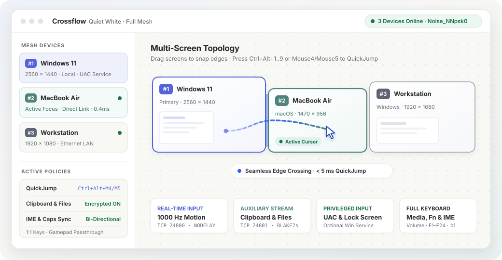
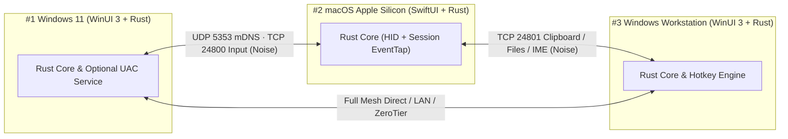

<div align="center">


# Crossflow

**Low-latency, end-to-end encrypted P2P mouse, keyboard, clipboard & file sharing**

Windows 11 ↔ macOS · N-Device Full Mesh · Pure Rust Core · Native WinUI 3 & SwiftUI

<p>
  <a href="README.md">
    
  </a>
  <a href="README.en.md">
    
  </a>
</p>

<p>
  <a href="https://github.com/Lokilankaaa/crossflow/releases/latest">
    
  </a>
  
  
  
  
</p>

<p>
  <a href="https://github.com/Lokilankaaa/crossflow/releases/latest"><strong>⬇️ Download Latest</strong></a> ·
  <a href="#key-features">Key Features</a> ·
  <a href="#quick-start">Quick Start</a> ·
  <a href="#shortcuts">Shortcuts</a> ·
  <a href="#architecture">Architecture</a> ·
  <a href="#build-from-source">Build from Source</a>
</p>

<br />



</div>

---

## Key Features

<table>
  <tr>
    <td width="50%" valign="top">
      <h3>🌐 N-Device Full Mesh P2P</h3>
      Zero-configuration LAN discovery via mDNS (<code>_crossflow._tcp.local.</code>) with no master/client hierarchy—connect 3+ Windows and macOS devices seamlessly.<br/><br/>
      Automatic multi-network link prioritization (<strong>Direct Ethernet &gt; Wired LAN &gt; Wi-Fi &gt; ZeroTier</strong>) that filters proxy TUNs and invalid link-local addresses, with manual NIC binding and direct IP overrides. Full <code>Noise_NNpsk0</code> end-to-end encryption (Curve25519 + ChaCha20-Poly1305 + BLAKE2s) with optional shared passphrase isolation.
    </td>
    <td width="50%" valign="top">
      <h3>⚡ Global Screen Numbers &amp; &lt; 5 ms QuickJump</h3>
      Deterministic global screen numbering (<code>#1</code>–<code>#9</code>) arranged by spatial rows and synced live across both the drag-and-snap canvas and device sidebar.<br/><br/>
      Instant <strong>&lt; 5 ms</strong> focus switching without waiting for modifier release, supporting direct jump to <code>#1</code>–<code>#9</code> and <strong>Prev / Next screen cycling</strong>. Record pure-custom prefixes and chords via native low-level hooks—including <code>Mouse4</code> / <code>Mouse5</code> / <code>MouseMid</code>, <code>F1–F24</code>, and <code>CapsLock</code>—while preserving local Gamepad passthrough.
    </td>
  </tr>
  <tr>
    <td width="50%" valign="top">
      <h3>⌨️ 1000 Hz Input &amp; Full System Keys</h3>
      Windows Raw Input + low-level hook routing paired with macOS dual-layer <code>kCGHIDEventTap</code> + <code>kCGSessionEventTap</code> capture for zero-delay cursor handoffs with no edge snags.<br/><br/>
      True <strong>1:1 key passthrough</strong> by default (no forced <code>Ctrl</code> / <code>Cmd</code> swap, preserving native macOS <code>Ctrl</code> shortcuts and Mission Control / Spaces). Full support for <code>Caps Lock</code>, <code>Fn/Globe</code>, Numpad, <code>F1–F24</code>, <code>PrtSc/ScrLk/Pause</code> (mapped to macOS <code>F13–F15</code>), <strong>bi-directional Volume &amp; Media keys</strong>, and Windows consumer launch keys (Calculator, Mail, Explorer, Media Stop, Browser Home).
    </td>
    <td width="50%" valign="top">
      <h3>🛡️ Optional Windows System Service Mode</h3>
      Built-in optional <code>CrossflowInputService</code> (<code>LocalSystem</code> privilege over a hardened local named pipe), installable, updatable, and uninstallable with one click in Settings.<br/><br/>
      Seamlessly delivers cross-screen mouse and keyboard input across <strong>UAC Secure Desktops, elevated Administrator windows (Task Manager, Admin Terminal), and the Windows Lock Screen</strong>.
    </td>
  </tr>
  <tr>
    <td width="50%" valign="top">
      <h3>📋 Encrypted Clipboard &amp; Streaming File Transfer</h3>
      Dedicated encrypted auxiliary channel (TCP <code>24801</code>) completely decoupled from the real-time input channel (TCP <code>24800</code>), so large file transfers never add cursor jitter.<br/><br/>
      Syncs plain text (≤ 4 MiB) and screenshots/PNG images (≤ 16 MiB, auto-converting Windows <code>CF_DIB</code>) with BLAKE2s echo protection. Copy files or folders with <strong><code>Ctrl+C</code> / <code>Cmd+C</code></strong> or drag-and-drop to stream in 32 KiB encrypted chunks with per-file BLAKE2s verification, atomic <code>.part</code> writes into <code>Downloads/Crossflow</code>, and automatic remote clipboard refill.
    </td>
    <td width="50%" valign="top">
      <h3>🌙 Wake-on-Entry, IME Sync &amp; Quiet White UI</h3>
      Prevents idle system sleep while still allowing displays to dim and save power; moving the cursor into a dimmed peer wakes it immediately for direct lock-screen password entry.<br/><br/>
      Real-time bi-directional <strong>IME input language &amp; Caps Lock synchronization</strong> (Windows IMM32/HKL ↔ macOS HIToolbox/IOKit); unified Quiet White native UI (WinUI 3 &amp; SwiftUI) with resizable sidebar splitters, titlebar double-click maximize/restore, and 4-state tray/menu-bar status icons.
    </td>
  </tr>
</table>

---

## Quick Start

Download the latest prebuilt release from [**GitHub Releases**](https://github.com/Lokilankaaa/crossflow/releases/latest):

| Platform | Package | Environment & Notes |
| :--- | :--- | :--- |
| **Windows (x64)** | `Crossflow-vX.Y.Z-windows-x64.zip` | Windows 10 19041+ / Windows 11 · Self-contained WinUI 3 + .NET 10 runtime, extract & run |
| **macOS (Apple Silicon)** | `Crossflow-vX.Y.Z-macos-arm64.dmg` / `.zip` | macOS 14.0+ (M1 / M2 / M3 / M4) · Drag `Crossflow.app` to Applications |
| **Checksums** | `SHA256SUMS.txt` | SHA-256 verification for all release artifacts |

> [!TIP]
> **Windows System Service Mode (Optional)**: After extracting and launching `Crossflow.Windows.exe`, open Settings and click **Install System Service** to enable input across UAC prompts, Administrator windows, and the Lock Screen. After upgrading to a newer release, click **Update / Restart Service** to sync the service binary.

> [!NOTE]
> **macOS First-Run Permissions**:
> 1. If Gatekeeper prompts on an unnotarized build, clear the quarantine attribute once in Terminal:
>    ```sh
>    xattr -dr com.apple.quarantine /Applications/Crossflow.app
>    ```
> 2. On first launch, grant **Accessibility** and **Input Monitoring** permissions to `Crossflow.app` in **System Settings → Privacy & Security**.

---

## Shortcuts

| Action | Default / Example | Details |
| :--- | :--- | :--- |
| **QuickJump by Screen #** | Custom Prefix + `1`–`9` | Jumps directly to global screen `#1`–`#9` displayed on the canvas and sidebar |
| **Prev / Next Screen Cycle** | e.g. `Ctrl+Alt+Mouse5` / `Ctrl+Alt+Mouse4` | Supports hardware recording of any keyboard key or mouse side/middle button; hold prefix to cycle continuously |
| **Safe Emergency Stop** | Windows: `Ctrl + Alt + Esc`<br/>macOS: `Control + Option + Esc` | Immediately releases remote control back to the local machine (**never hijacks bare `Esc`**) |

---

## Architecture

Crossflow uses a **dual-channel encrypted, serverless Full Mesh** architecture: every peer connects symmetrically, isolating high-frequency input from bulk clipboard/file streams on separate encrypted TCP connections so cursor motion stays locked at 1000 Hz even during large transfers.



| Port | Protocol | Purpose |
| :--- | :--- | :--- |
| `5353` | UDP | mDNS local peer discovery (`_crossflow._tcp.local.`) |
| `24800` | TCP (`TCP_NODELAY`) | `Noise_NNpsk0` encrypted real-time mouse, keyboard, scroll & topology channel |
| `24801` | TCP | `Noise_NNpsk0` encrypted auxiliary channel (clipboard, streaming files/folders, IME & Caps Lock sync) |

---

## Build from Source

<details>
<summary><strong>📁 Project Structure</strong></summary>

```text
.
├── src/                               # Shared Rust core (peer_mesh, mesh_runtime, hotkeys, pair_*, aux_channel, clipboard, input_state, power, windows_service, platform/)
├── crates/crossflow-bridge/           # C ABI bridge library (layout validation & edge routing for WinUI 3 / SwiftUI)
├── clients/
│   ├── design-tokens.json             # Shared Quiet White design tokens
│   ├── windows/Crossflow.Windows/     # Native Windows WinUI 3 client
│   └── macos/                         # Native macOS SwiftUI / AppKit menu-bar app
├── assets/                            # Master app icon (AppIcon-1024.png) & README visual assets
├── scripts/                           # Cross-platform build & portable toolchain scripts
└── docs/                              # Architecture & protocol design documentation
```

</details>

<details>
<summary><strong>🪟 Windows Build &amp; Test (Rust 1.85+ &amp; .NET 10 SDK)</strong></summary>

```powershell
# Run Rust unit tests
.\scripts\cargo-local.ps1 test --lib

# Build Release core, bridge DLL, and self-contained WinUI 3 client
.\scripts\build-windows-ui.ps1 -Configuration Release
```

Output binary: `clients\windows\Crossflow.Windows\bin\x64\Release\net10.0-windows10.0.19041.0\win-x64\Crossflow.Windows.exe`

</details>

<details>
<summary><strong>🍎 macOS Build &amp; Test (Rust 1.85+ &amp; Xcode Command Line Tools)</strong></summary>

```sh
# Run Rust unit tests
cargo test --lib

# Build Apple Silicon Release core, Keychain helper, and bridge dylib
cargo build --release --target aarch64-apple-darwin \
  --bin crossflow --bin crossflow-keychain -p crossflow -p crossflow-bridge

# Package native Crossflow.app (including automatic AppIcon.icns generation)
CROSSFLOW_MACOS_APP_PATH="$PWD/dist/cross-screen/Crossflow.app" \
CROSSFLOW_CORE_EXECUTABLE="$PWD/target/aarch64-apple-darwin/release/crossflow" \
CROSSFLOW_MACOS_KEYCHAIN_HELPER="$PWD/target/aarch64-apple-darwin/release/crossflow-keychain" \
CROSSFLOW_BRIDGE_LIBRARY="$PWD/target/aarch64-apple-darwin/release/libcrossflow_bridge.dylib" \
sh ./scripts/build-macos-ui.sh
```

</details>
