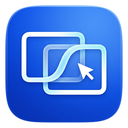
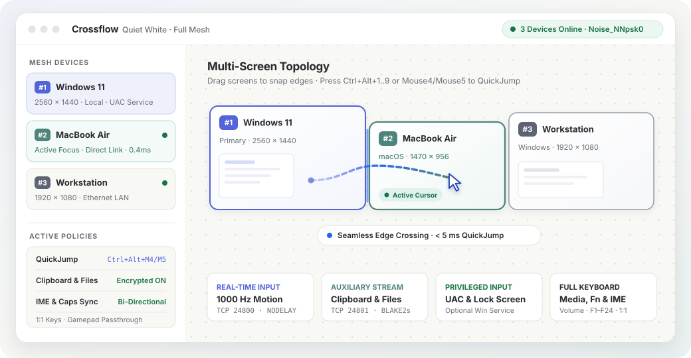
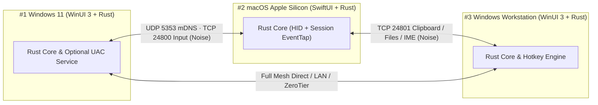

<div align="center">



# Crossflow

**低延迟、端到端加密的跨平台 P2P 键鼠、剪贴板与文件共享工具**

Windows 11 ↔ macOS · N 设备全互联 Full Mesh · 纯 Rust 内核 · 原生 WinUI 3 & SwiftUI

<p>
  <a href="https://github.com/Lokilankaaa/crossflow/releases/latest">
    
  </a>
  
  
  
  
</p>

<p>
  <strong>简体中文</strong> · <a href="README.en.md">English</a>
</p>

<p>
  <a href="https://github.com/Lokilankaaa/crossflow/releases/latest"><strong>⬇️ 下载最新版</strong></a> ·
  <a href="#核心特性">核心特性</a> ·
  <a href="#快速开始">快速开始</a> ·
  <a href="#快捷键速查">快捷键</a> ·
  <a href="#架构设计">架构设计</a> ·
  <a href="#从源码构建">从源码构建</a>
</p>

<br />



</div>

---

## 核心特性

<table>
  <tr>
    <td width="50%" valign="top">
      <h3>🌐 N 设备全互联 Full Mesh</h3>
      基于 mDNS（<code>_crossflow._tcp.local.</code>）局域网自动发现，无主/从机之分，支持 3 台及以上 Windows / macOS 设备自由组网。<br/><br/>
      智能优选多网络信道（<strong>有线直连 &gt; 有线局域网 &gt; Wi-Fi &gt; ZeroTier</strong>），自动过滤代理 TUN 与无效链路地址，支持指定网卡与直连 IP；全链路 <code>Noise_NNpsk0</code> 端到端加密，可选口令隔离分组。
    </td>
    <td width="50%" valign="top">
      <h3>⚡ 全局编号与毫秒级闪切（QuickJump）</h3>
      全网显示器按空间行列确定性编号（<code>#1</code>–<code>#9</code>），画布与侧边栏实时高亮同步。<br/><br/>
      无需等待修饰键松开（<strong>&lt; 5 ms 即时切换</strong>），支持按编号直达及<strong>上一屏 / 下一屏循环切换</strong>；完全自由的自定义前缀与键鼠录制（含 <code>Mouse4</code> / <code>Mouse5</code> / <code>MouseMid</code>、<code>F1–F24</code>、<code>CapsLock</code>），切屏保留本机手柄（Gamepad）直通。
    </td>
  </tr>
  <tr>
    <td width="50%" valign="top">
      <h3>⌨️ 1000Hz 全键位与系统功能键共享</h3>
      Windows 端采用 Raw Input + 低级钩子路由，macOS 端采用 <code>kCGHIDEventTap</code> + <code>kCGSessionEventTap</code> 双层捕获，零延迟光标回归不卡边界。<br/><br/>
      默认 <strong>1:1 原样键位直通</strong>（不强制互换 <code>Ctrl</code> / <code>Cmd</code>），完整支持 <code>Caps Lock</code>、<code>Fn/Globe</code>、小键盘、<code>F1–F24</code>、<code>PrtSc/ScrLk/Pause</code>（自动映射 macOS <code>F13–F15</code>）、<strong>双向音量与多媒体键</strong>，以及计算器 / 邮件 / 资源管理器等消费级功能键。
    </td>
    <td width="50%" valign="top">
      <h3>🛡️ Windows 可选系统服务模式</h3>
      内置可选 <code>CrossflowInputService</code>（<code>LocalSystem</code> 权限，通过受限本地命名管道通信），在应用设置页一键安装、更新或卸载。<br/><br/>
      启用后可在 <strong>UAC 安全桌面、管理员权限窗口（任务管理器 / 终端等）与 Windows 锁屏界面</strong> 下无缝继续接收跨屏输入。
    </td>
  </tr>
  <tr>
    <td width="50%" valign="top">
      <h3>📋 加密剪贴板 &amp; 流式文件/文件夹直传</h3>
      独立加密辅助通道（TCP <code>24801</code>）与键鼠主通道（TCP <code>24800</code>）完全解耦，传大文件零鼠标抖动。<br/><br/>
      支持纯文本（≤ 4 MiB）、截图/PNG（≤ 16 MiB，自动转码 <code>CF_DIB</code>）与 BLAKE2s 防回环；支持 <strong><code>Ctrl+C</code> / <code>Cmd+C</code> 复制文件或文件夹跨屏自动直传</strong> 与拖入发送，32 KiB 加密分块 + 逐文件校验 + <code>.part</code> 原子落盘至 <code>Downloads/Crossflow</code> 并自动回填剪贴板。
    </td>
    <td width="50%" valign="top">
      <h3>🌙 熄屏唤醒、输入法同步与静白托盘</h3>
      阻止系统空闲休眠但允许熄屏节能，远端鼠标移入自动唤醒屏幕并支持直接输入锁屏密码。<br/><br/>
      跨屏实时双向同步 <strong>中英文输入法与 Caps Lock 状态</strong>（Windows IMM32/HKL ↔ macOS HIToolbox/IOKit）；双端原生「静白」界面（WinUI 3 / SwiftUI），支持可拖拽侧边栏、双击标题栏最大化与 4 态托盘/菜单栏图标常驻。
    </td>
  </tr>
</table>

---

## 快速开始

前往 [**GitHub Releases**](https://github.com/Lokilankaaa/crossflow/releases/latest) 下载对应平台发行包：

| 平台 | 发行包 | 运行环境与说明 |
| :--- | :--- | :--- |
| **Windows (x64)** | `Crossflow-vX.Y.Z-windows-x64.zip` | Windows 10 19041+ / Windows 11 · 自包含 WinUI 3 与 .NET 10 运行时，解压即用 |
| **macOS (Apple Silicon)** | `Crossflow-vX.Y.Z-macos-arm64.dmg` / `.zip` | macOS 14.0+（M1 / M2 / M3 / M4）· 拖入「应用程序」即可运行 |
| **校验文件** | `SHA256SUMS.txt` | 用于核验安装包完整性 |

> [!TIP]
> **Windows 系统服务模式（可选）**：解压运行 `Crossflow.Windows.exe` 后，如需穿透 UAC 弹窗、管理员窗口或锁屏输入，可在设置页点击 **「安装系统服务」**（后续版本升级后点击 **「更新 / 重启服务」** 即可同步）。

> [!NOTE]
> **macOS 首次运行权限**：
> 1. 若因未公证触发系统门禁提示，可在终端执行一次：
>    ```sh
>    xattr -dr com.apple.quarantine /Applications/Crossflow.app
>    ```
> 2. 首次启动需在 **「系统设置 → 隐私与安全性」** 中为 `Crossflow.app` 开启 **辅助功能（Accessibility）** 与 **输入监控（Input Monitoring）** 权限。

---

## 快捷键速查

| 功能 | 默认 / 推荐配置 | 说明 |
| :--- | :--- | :--- |
| **按全局编号闪切屏幕** | 自定义前缀 + `1`–`9` | 对应画布与侧边栏的 `#1`–`#9` 全局屏幕编号 |
| **上一屏 / 下一屏循环切换** | 如 `Ctrl+Alt+Mouse5` / `Ctrl+Alt+Mouse4` | 支持任意键盘键与鼠标中键/侧键硬件录制，按住修饰键可连续切换 |
| **安全紧急停止** | Windows：`Ctrl + Alt + Esc`<br/>macOS：`Control + Option + Esc` | 随时立即释放远端输入归还控制权（**绝不占用单独 `Esc` 键**） |

---

## 架构设计

Crossflow 采用 **双通道加密 + 无中心 Full Mesh** 架构：所有节点对等互联，实时键鼠与大文件/剪贴板彻底隔离在不同加密 TCP 连接中，确保高负载传输下光标依旧维持 1000Hz 丝滑响应。



| 端口 | 协议 | 用途 |
| :--- | :--- | :--- |
| `5353` | UDP | mDNS 局域网自动发现（`_crossflow._tcp.local.`） |
| `24800` | TCP (`TCP_NODELAY`) | `Noise_NNpsk0` 加密实时键鼠、滚轮与多屏拓扑主通道 |
| `24801` | TCP | `Noise_NNpsk0` 加密辅助通道（剪贴板、流式文件/文件夹、输入法与大小写同步） |

---

## 从源码构建

<details>
<summary><strong>📁 项目目录结构</strong></summary>

```text
.
├── src/                               # Rust 共享核心（peer_mesh, mesh_runtime, hotkeys, pair_*, aux_channel, clipboard, input_state, power, windows_service, platform/）
├── crates/crossflow-bridge/           # C ABI 桥接库（供 WinUI 3 / SwiftUI 调用布局校验与跨屏计算）
├── clients/
│   ├── design-tokens.json             # 双端共享「静白（Quiet White）」设计令牌
│   ├── windows/Crossflow.Windows/     # Windows 原生 WinUI 3 客户端
│   └── macos/                         # macOS 原生 SwiftUI / AppKit 菜单栏应用
├── assets/                            # 应用图标母版（AppIcon-1024.png）与 README 视觉资源
├── scripts/                           # 双端构建与便携工具链脚本
└── docs/                              # 架构与协议设计文档
```

</details>

<details>
<summary><strong>🪟 Windows 构建与测试（Rust 1.85+ &amp; .NET 10 SDK）</strong></summary>

```powershell
# 运行 Rust 单元测试
.\scripts\cargo-local.ps1 test --lib

# 构建 Release 内核、桥接库与自包含 WinUI 3 客户端
.\scripts\build-windows-ui.ps1 -Configuration Release
```

输出产物：`clients\windows\Crossflow.Windows\bin\x64\Release\net10.0-windows10.0.19041.0\win-x64\Crossflow.Windows.exe`

</details>

<details>
<summary><strong>🍎 macOS 构建与测试（Rust 1.85+ &amp; Xcode Command Line Tools）</strong></summary>

```sh
# 运行 Rust 单元测试
cargo test --lib

# 编译 Apple Silicon Release 内核、Keychain 助手与桥接库
cargo build --release --target aarch64-apple-darwin \
  --bin crossflow --bin crossflow-keychain -p crossflow -p crossflow-bridge

# 打包原生 Crossflow.app（含自动生成 AppIcon.icns）
CROSSFLOW_MACOS_APP_PATH="$PWD/dist/cross-screen/Crossflow.app" \
CROSSFLOW_CORE_EXECUTABLE="$PWD/target/aarch64-apple-darwin/release/crossflow" \
CROSSFLOW_MACOS_KEYCHAIN_HELPER="$PWD/target/aarch64-apple-darwin/release/crossflow-keychain" \
CROSSFLOW_BRIDGE_LIBRARY="$PWD/target/aarch64-apple-darwin/release/libcrossflow_bridge.dylib" \
sh ./scripts/build-macos-ui.sh
```

</details>
